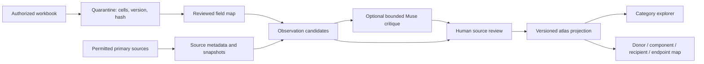

# Integration with the existing Traitweaver atlas

Baseline inspected: `caf307bea69abab315bba24664259a92c714ad94` in
`Y3K5/traitweaver`. The main checkout and all historical app contracts remain
unchanged. This study is a separate package under `research/transferable-traits/`.
No server endpoint or browser action is connected to a provider.

## Data path

The current implementation covers synthetic input, six real candidate/source-note
preparations, local normalized storage,
offline request preparation, structural validation, durable queue/review and
static projection. Workbook column mapping, network retrieval, live Muse
execution, object storage and native app integration remain separate work.

## Adapter proposal

1. Introduce a versioned read-only `traitweaver.cloud-study.v1` importer beside
   the existing catalog owners. Validate hashes, required fields and provenance;
   do not mutate `intelligence.py`, `evidence_map.py` or existing GFP/algae records.
2. Extend `src/traitweaver/web/trait-categories-ui.js` with a separate source selector
   and scheme selector only after the importer is tested. The existing six
   capability lenses remain `app_capabilities_v1`; preserve workbook categories
   in `workbook_human_v1`, proposed clusters in `muse_proposed_v1`.
3. Use a separate evidence graph projection, with nodes for organism context,
   component identity, study/condition and assay endpoint. Every edge retains
   observation ID, exact source locator, review state and immutable revision hash.
   Reference-only gene/protein mappings must not be drawn as demonstrated transfer.
4. Offer filters for recipient, component, endpoint scope, evidence type,
   reviewer state and category scheme. Default to reviewed real observations once
   available; keep synthetic examples explicitly selectable and visibly labeled.
5. Display dependency gaps and negative observations beside positive evidence.
   Show `extracted_enzyme` as activity of recipient-produced/extracted material;
   require separate intact-cell/organism evidence for those outcomes. Avoid a
   scalar score or cross-study biological ranking.
6. Proposed pairs use dashed links and a future-study label. Demonstrated stack
   claims require shared context, a joint primary-source locator and human review;
   a common protein or separate successful studies is insufficient.
7. Review/export binds the exact snapshot hash and preserves all reviewer history.
   The browser never sends model requests. A future private worker prepares a
   separate exact packet; only an approved runner can transmit it.

## Storage and source handling

`sources` holds immutable source metadata/text hashes and canonical work keys;
`entities` normalizes organism contexts and components. `observations`,
`observation_components`, `citations`, `dependencies` and `category_assignments`
retain searchable links. `groups_`/`group_members` retain combination roles;
`reviews` records decisions without rewriting evidence. `jobs`/`events` retain
leases, retries and checkpoints, and `budgets`/`reservations` retain bounded
accounting. Output JSON includes the full context, uncertainty and reviewer state.

Exact content duplicates reuse IDs. Changed observations remain parallel immutable
revisions with an identity key. Automatic DOI/PMID equivalence, synonym merging,
canonical species resolution and retraction discovery are not yet implemented;
route those conflicts to a human rather than discarding records. An explicit
reviewed supersession selector will be needed before a production UI counts only
one current revision. Until then, display observation/revision counts accurately.

Source snapshots are optional and bounded; rights-restricted content may be kept
as metadata only. A future fetcher needs allowlisted hosts, HTTPS with existing
proxy/CA settings, redirect checks, time/byte limits, per-host rate limits,
Retry-After/backoff, policy-denial stops and no direct-network fallback. Cache by
canonical ID and snapshot hash. DOIs resolve publications; accession versions
resolve reference entities. Neither alone establishes claim entailment.

## Remaining engineering work before production

- Binary workbook verification and reviewed normalization of the selected rows;
  parsed text and a six-paper source sample are now available.
- Licensed document ingestion/object store and tested provider-specific parsers.
- A reviewed extraction contract beyond the initial immutable-record critique.
- Actual source-entailment and reviewer-agreement evaluation.
- Account-level credit-only protection and a separately reviewed live transport.
- Reconciliation of uncertain requests without automatic resend.
- Multi-reviewer authentication, backups, migrations, retention and deletion policy.
- Native atlas adapter and browser accessibility/layout validation.

Do not deploy this as an unattended production research service yet. The isolated
offline package is useful now for record review, trial design and software checks.
